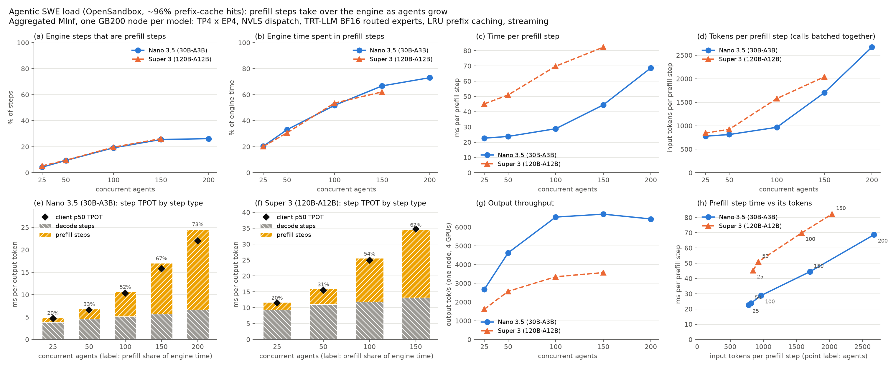

# Agentic load: prefill steps take over the engine as agents grow

**Setup.** SWE-bench agents (mini-swe-agent on OpenSandbox) against one aggregated MInf server per
model: 1 GB200 node, TP4 x EP4, NVLS dispatcher, TRT-LLM BF16 routed experts, LRU prefix caching,
streaming. Nemotron 3.5 Lightning 30B-A3B and Nemotron 3 Super 120B-A12B (official HF releases).
Agents ramp 25 -> 50 -> 100 -> 150 -> 200, 5 min per level, without restarting the server.
Engine counters come from `/metrics` once a minute (`server/step_mix_watch.py`); latencies from
the harness. Each level drops its first minute and its drain minutes. Data: `summary.csv`.

## Result

| Model | Agents | Prefill % of steps | Prefill % of time | Prefill tok/step | Decode step | Step TPOT | Client p50 TPOT | Output tok/s |
|---|---|---|---|---|---|---|---|---|
| Nano | 25 | 4.3 | 20 | 777 | 4.0 ms | 4.8 ms | 4.7 ms | 2,677 |
| Nano | 50 | 9.4 | 33 | 812 | 5.0 ms | 6.8 ms | 6.6 ms | 4,626 |
| Nano | 100 | 19.1 | 52 | 966 | 6.3 ms | 10.6 ms | 10.3 ms | 6,535 |
| Nano | 150 | 25.5 | 67 | 1,704 | 7.6 ms | 17.0 ms | 15.8 ms | 6,690 |
| Super | 25 | 5.2 | 20 | 844 | 9.9 ms | 11.7 ms | 11.5 ms | 1,617 |
| Super | 50 | 9.6 | 31 | 923 | 12.2 ms | 15.9 ms | 15.5 ms | 2,570 |
| Super | 100 | 19.6 | 54 | 1,578 | 14.8 ms | 25.6 ms | 24.9 ms | 3,349 |

- **The engine-side split is the client's TPOT.** Step TPOT (engine wall time / steps) matches the
  harness's p50 TPOT within ~7% at every level, so panels (c, d) decompose what users see.
- **Prefill grows with agents; decode barely does.** From 25 to 150 agents (Nano), the decode step
  goes 4.0 -> 7.6 ms while the prefill part of TPOT goes 1.0 -> 11.3 ms. At 150 agents two thirds
  of the engine's time is prefill.
- **Throughput saturates where prefill dominates.** Nano's output tok/s flattens at ~6.5-6.7k from
  100 agents on, while TPOT keeps rising.
- **Both models follow the same prefill-share curve** (20% -> ~33% -> ~53% at 25/50/100 agents).

## Mechanism

Each agent turn is one LLM call. With ~96% of the prompt cached, a call prefills only its new
suffix (~800 tokens), so prefill work arrives at the call rate, which grows with the number of
agents. A decode step serves every running request at once and costs about the same however many
ride in it, so decode work barely grows. Every running request waits through every step, so each
prefill step (25-70 ms) stalls the whole batch: TPOT = decode step + (prefill time / steps).

At higher load, several calls land in the same prefill step (prefill tokens per step rise from
~800 to ~1,700 at 150 agents), so the prefill share of steps grows sub-linearly but each prefill
step gets longer. The hit rate also drops at high load (Nano 96% -> 93%, Super 95% -> 90%), which
adds prefill work.

## Caveats

- 5-minute levels never reach a steady state: agents restart with short histories each level, and
  throughput falls within a level as histories grow (Nano 150 agents: 7.5k -> 5.6k tok/s).
- One run per level; no error bars.
- What causes the hit-rate drop (eviction vs new tasks) is not measured.
